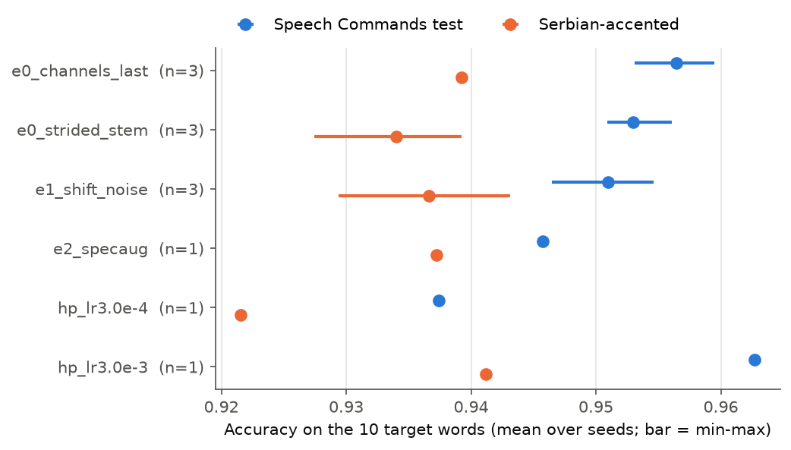
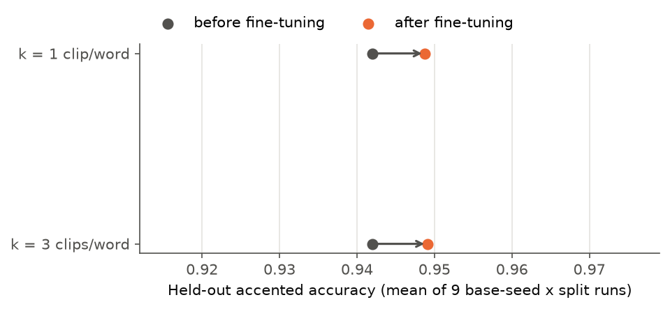
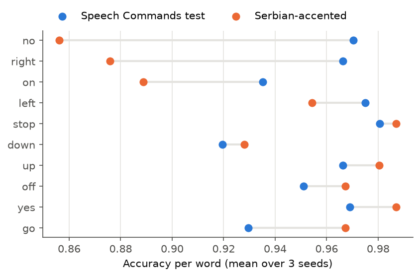
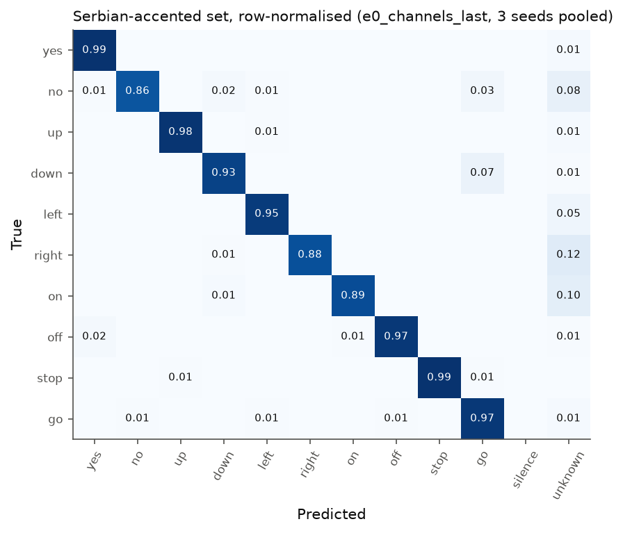

# kws-accent-robustness

Measuring and reducing the accuracy gap of a keyword-spotting CNN on
Serbian-accented speech. A small CNN (99k parameters, CPU-trained) is trained
on Google Speech Commands v2, then tested on an original, consented set of 19
Serbian-accented speakers. Two cheap fixes are compared: training-time
augmentation and few-shot fine-tuning. Full write-up:
[reports/report.md](reports/report.md).

# Results

**Headline:** on the 10 command words, accuracy drops from 0.957 on the Speech
Commands test set to 0.939 on 19 Serbian-accented speakers (gap 1.7 points,
95% CI roughly −2 to +7 points). Generic augmentation does not close it;
fine-tuning on 1 clip per word from 5 accented speakers recovers 0.7 points
on the other speakers. The gap is driven by a few speakers: without the two
weakest, accented accuracy is 0.964.

E0 on the final defaults (`channels_last`, lr 1e-3), 3 seeds, val macro-F1
0.9494 ± 0.0010, test macro-F1 0.9522 ± 0.0037 (MLflow runs `a1fde9e9` /
`8f065f3a` / `3c69454d` for seeds 0 / 1 / 2). Final log line of seed 2:

```
best epoch 27 | val_acc 0.9505 | val_f1 0.9505 | test_acc 0.9552 | test_f1 0.9550
```

## All experiments

Mean ± std over seeds. "Official" is the Speech Commands test set (12 classes
for test F1, the 10 target words for the accuracy and gap columns), "accented"
the Serbian-accented set, gap = official − accented accuracy. Model selection
used validation macro-F1 only, never the accented set.

| Experiment | Seeds | Val F1 | Test F1 | Official acc (10 w) | Accented acc | Gap |
|---|---|---|---|---|---|---|
| E0 `channels_last` (final defaults) | 3 | 0.9494 ± 0.0010 | 0.9522 ± 0.0037 | 0.9565 ± 0.0032 | 0.9392 ± 0.0000 | 0.0173 ± 0.0032 |
| E0 + strided stem | 3 | 0.9459 ± 0.0006 | 0.9484 ± 0.0041 | 0.9530 ± 0.0027 | 0.9340 ± 0.0060 | 0.0190 ± 0.0085 |
| E1 time shift + noise | 3 | 0.9504 ± 0.0042 | 0.9466 ± 0.0029 | 0.9510 ± 0.0041 | 0.9366 ± 0.0069 | 0.0144 ± 0.0049 |
| E2 E1 + SpecAugment | 1 | 0.9405 | 0.9382 | 0.9458 | 0.9373 | 0.0085 |
| HP lr 3e-4 | 1 | 0.9274 | 0.9322 | 0.9374 | 0.9216 | 0.0158 |
| HP lr 3e-3 | 1 | 0.9559 | 0.9616 | 0.9627 | 0.9412 | 0.0215 |



Paired comparisons against E0 (`scripts/compare_runs.py`: the same speakers
are resampled for both models, so per-speaker difficulty cancels out; 95% CI):

| vs. E0 | Official acc | Accented acc | Gap |
|---|---|---|---|
| strided stem | −0.0035 [−0.0077, +0.0006] | −0.0052 [−0.0205, +0.0088] | +0.0017 [−0.0132, +0.0175] |
| E1 shift + noise | −0.0055 [−0.0105, −0.0004] | −0.0026 [−0.0121, +0.0061] | −0.0029 [−0.0126, +0.0077] |
| E2 + SpecAugment | −0.0107 [−0.0196, −0.0023] | −0.0020 [−0.0150, +0.0098] | −0.0088 [−0.0237, +0.0070] |
| lr 3e-3 | +0.0062 [+0.0007, +0.0119] | +0.0020 [−0.0082, +0.0118] | +0.0043 [−0.0069, +0.0158] |

- **Strided stem: not adopted.** Decision rule fixed before the seeds 1–2
  runs: adopt it if its mean val macro-F1 is at most 0.002 below
  `channels_last`. It came out 0.0036 below (seed std ~0.001), so it stays
  opt-in: 32% faster epochs (15.5 vs. 22.8 s) for ~0.35 points.
- **Augmentation does not help here.** E1 matches E0 on validation and is
  slightly worse on the official test; E2 is worse on both. Neither changes
  accented accuracy or the gap measurably. E1 still peaks at the last epoch
  (28–30), so it may need a longer schedule than 30 epochs.
- **Learning rate: 3e-3 is the best single run** (+0.6 points official,
  CI excludes 0); 3e-4 is clearly too low. 3e-3 has one seed only, and all
  experiments above (and E3 below) use 1e-3; see [NEXT_STEPS.md](NEXT_STEPS.md).
- Epoch times for E1 seeds 1–2 and the LR runs were measured with two runs
  in parallel at 4 threads each (~37 s/epoch); they are not comparable to the
  sequential runs.

## E3: few-shot fine-tuning on accented speakers

`scripts/finetune_accented.py`: 5 adaptation speakers (drawn from the 16
with 3 reps), k clips per word each, 200 AdamW steps at lr 1e-4, every batch
32 accented + 96 replayed Speech Commands clips. Tested on the 14 other
speakers; 3 random splits × the 3 E0 seeds. Settings fixed in advance, not
tuned on accented data (the one design check, frozen vs. updating BatchNorm,
was decided on the official validation split).

| k | Adaptation clips | Held-out acc before | after | Δ acc | Δ official acc (12 cl.) |
|---|---|---|---|---|---|
| 1 | 50 | 0.9420 ± 0.0158 | 0.9488 ± 0.0155 | +0.0068 ± 0.0065 | −0.0026 ± 0.0020 |
| 3 | 150 | 0.9420 ± 0.0158 | 0.9491 ± 0.0189 | +0.0071 ± 0.0067 | −0.0031 ± 0.0030 |

Mean ± std over the 9 base-seed × split runs. Fine-tuning helps a little and
fairly consistently (improves 6 of 9 runs for k=1 and 7 of 9 for k=3, one
run gets worse in each), at a cost of ~0.3 points on the official set; 3
clips per word are no better than 1. The per-run paired CIs
(`runs/<E0 run>/e3_finetune.json`) exclude 0 in only 1 (k=1) and 2 (k=3) of
9 runs: each held-out set has only 14 speakers. Part of the gain
may be channel adaptation (phone codecs) rather than accent adaptation, since
the two cannot be separated with this data.



## Accent gap and error analysis (E0)

Scored on the 10 target words only, since the accented set has no
silence/unknown clips. Accented set: 19 speakers, 510 clips
([data_accented/README.md](data_accented/README.md)). Details in
[notebooks/error_analysis.ipynb](notebooks/error_analysis.ipynb).

- **Top failure mode: accented target words rejected as `_unknown_`.** 65% of
  accented errors are `→ _unknown_` (vs. 27% on Speech Commands, where most
  errors are confusions between words such as `go → no`, `off → up`). The top
  three are `right`, `on` and `no → _unknown_`. Hypothesis, still to be
  checked by listening to the clips the notebook lists: the Serbian
  realisations (tapped/trilled *r*, a pure vowel in *no* instead of the
  diphthong /oʊ/, a different vowel in *on*) fall outside what the model
  learned for these words, so they look more like the many words lumped into
  `_unknown_` than like any one target.
- **Hardest words:** `no` 0.86, `right` 0.88, `on` 0.89 on accented speech,
  vs. 0.97, 0.97 and 0.94 on Speech Commands. `go`, `off` and `up` are
  *easier* on the accented set.
- **The gap is concentrated in two speakers.** `spk09` (0.62) and `spk16`
  (0.73) are the weakest for every model; without them accented accuracy is
  0.964, above the official 0.957. Only `spk09` is one of the hand-cleaned
  recordings (`spk07`–`spk11`).




## Deployment: ONNX + FastAPI

The exported model includes the log-mel front end (the STFT as a fixed
conv1d), so the server takes raw 16 kHz audio and needs only ONNX Runtime and
numpy. 98,940 parameters, 1.1 MB ONNX file, 290 MB Docker image.

Latency per 1 s clip, batch 1, AMD Ryzen 7 7735HS, 500 Speech Commands test
clips, waveform in memory → logits (`reports/latency.json`):

| | 1 thread p50 / p95 | 8 threads p50 / p95 |
|---|---|---|
| PyTorch (torchaudio features + model) | 0.86 / 0.90 ms | 0.52 / 0.57 ms |
| ONNX Runtime (one graph) | 0.54 / 0.56 ms | 0.19 / 0.26 ms |

Top-1 predictions agree on all 500 clips; logits match to < 1e-5
(`tests/test_onnx_parity.py`).

```
uv run --extra serve python scripts/export_onnx.py runs/<run>
docker build -f serve/Dockerfile --build-arg MODEL=runs/<run>/model.onnx -t kws-serve .
docker run --rm -p 8000:8000 kws-serve
curl --data-binary @clip.wav -H "Content-Type: audio/wav" localhost:8000/predict
```

## How to run

```
uv run python scripts/download_data.py
uv run python src/train.py [--set key=value ...]          # configs/baseline.yaml
uv run python scripts/evaluate_accented.py runs/<run>      # accent gap, CIs, predictions.npz
uv run python scripts/summarize_runs.py [names ...]        # mean ± std over seeds
uv run python scripts/compare_runs.py <baseline> <name ...> # paired speaker bootstrap
uv run python scripts/finetune_accented.py runs/<run> ...  # E3
uv run python scripts/make_figures.py --main <name> --experiments <name ...>
uv run --extra serve python scripts/benchmark_latency.py runs/<run>
uv run --extra serve pytest
```
