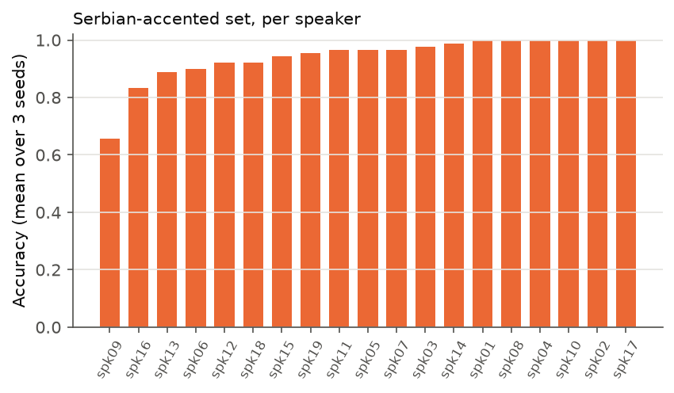

# Accent robustness of a small keyword-spotting CNN

*Technical report, October 2026. Code and run logs:
[github.com/vasicm4/kws-accent-robustness](https://github.com/vasicm4/kws-accent-robustness).*

## Abstract

A 99k-parameter CNN keyword spotter trained on Google Speech Commands v2
reaches 0.964 accuracy on the 10 command words of the official test set and
0.945 on an original set of 19 Serbian-accented speakers (510 clips). The gap
is 1.9 points, but its 95% speaker-bootstrap interval (about −1.5 to +7
points) includes zero, and it comes mostly from two speakers: without them,
accented accuracy is 0.966. Most accented errors (64%) are target words
rejected as `_unknown_`, mainly *on* and *right*. Generic training-time
augmentation (time shift, background noise, SpecAugment) does not change
accented accuracy measurably. Fine-tuning on one clip per word from five
accented speakers improves accuracy on the other 14 speakers by 1.0 point.
It does so in all 9 runs, with no measurable cost on the official test set.

## 1. Introduction

Keyword spotting (KWS) detects a small vocabulary of spoken commands on a
device, so the model has to be small and fast. The standard benchmark,
Speech Commands, was crowd-sourced through a web page with no record of the
speakers' accents and is generally assumed to be mostly native English. A
model that works on its test set may still fail on the speakers it is meant
to serve. This project measures that failure for one group, Serbian-accented
speakers of English, and tests two interventions that need no new
architecture or large data collection.

**Research question.** How much does a keyword spotter trained on mostly
native English speech degrade on Serbian-accented speakers, and which
low-cost intervention (augmentation or few-shot fine-tuning) reduces the gap
the most?

The hypotheses were written down before the accented experiments:

- **H1:** accuracy on the accented set is noticeably lower than on the
  official test set.
- **H2:** errors concentrate on phonetically close word pairs and on
  vowel-dependent words.
- **H3:** fine-tuning on a few accented speakers reduces the gap more than
  generic augmentation.

## 2. Data

**Speech Commands v2** (Warden, 2018; CC BY 4.0): 105,829 one-second clips of
35 words from 2,618 speakers, 16 kHz. The standard 12-class task is used: the
10 command words (`yes no up down left right on off stop go`), `_unknown_`
(the other 25 words) and `_silence_` (1 s crops from the dataset's
`_background_noise_` recordings). The official `validation_list.txt` and
`testing_list.txt` give speaker-disjoint splits. `_unknown_` and `_silence_`
are sampled per split to the average size of a target class, giving 36,923
training, 4,443 validation and 4,888 test clips.

**Serbian-accented set** (collected for this project): 19 speakers, 510 clips.
16 speakers said each word 3 times, 3 speakers once. Speakers recorded
themselves on their own phones, reading the 10 words in a fixed order;
recordings arrived as phone voice memos (AAC) and WhatsApp voice notes
(Opus). A script (`scripts/prepare_accented.py`) cuts them into clips with no
manual editing. It detects words by short-time energy with a per-recording
threshold, accepts a recording only if it yields exactly 10 or 30 words, and
cuts a 1 s window around each word from the original audio, so each clip
keeps the speaker's real background. Labels come from word position. A local
Whisper model cross-checked every clip. Its disagreements were used only to
choose clips to listen to, never to drop clips, because Whisper also
struggles with accented speech. The check found two recordings whose labels
had shifted by one word. Five noisy recordings were cleaned by hand in
Audacity before processing.

Every speaker gave written consent (in Serbian) covering recording, storage,
use and the right to withdraw. Publication was a separate, optional question.
Speakers are identified only as `spk01`–`spk19`. The audio is not published.
Only aggregate results are. Protocol details are in
[data_accented/README.md](../data_accented/README.md).

The accented set has no `_silence_` or `_unknown_` clips, so it is scored on
the 10 command words only. The model still predicts all 12 classes, so a
word classified as `_unknown_` counts as an error. For comparison, the
official numbers in the accent tables use the same 10-word subset of the
test set (4,074 clips).

## 3. Method

**Features.** 40-bin log-mel spectrogram (dB), 25 ms window, 10 ms hop, on
clips padded or trimmed to 1 s: a 40 × 101 input.

**Model.** Four 3 × 3 convolution blocks (16, 32, 64, 128 channels), each
with BatchNorm and ReLU, the first three followed by 2 × 2 max-pooling, then
global average pooling, dropout 0.3 and a linear layer to 12 classes:
98,940 parameters.

**Training.** Cross-entropy, AdamW (weight decay 0.01), batch 128, one epoch
of linear warmup to the peak learning rate, then cosine decay over 30
epochs. The checkpoint with the best validation macro-F1 is kept (early
stopping patience 10). The peak learning rate is the main tuned
hyperparameter. E0 to E2 use 1e-3. A sweep over {3e-4, 1e-3, 3e-3} selected
3e-3 on validation macro-F1, and the final model is E0 at 3e-3. Training
runs on a laptop CPU (AMD Ryzen 7 7735HS): about 23 s per epoch, 11 min per
run. Profiling showed that the convolution backward pass, not data loading
(about 2% of an epoch), dominated the time. Storing weights in
`channels_last` format cut epoch time by 17% and became the default. A
stride-2 first convolution cut it by a further 32%, but was rejected because
it cost 0.35 validation macro-F1 points over 3 seeds
([reports/profiling/](profiling/README.md)).

**Experiments.**

| ID | Change from E0 |
|---|---|
| E0 | Baseline, no augmentation, lr 1e-3 |
| E1 | Random time shift (±100 ms, zero fill) and background noise (p = 0.8, SNR 5–20 dB) |
| E2 | E1 + SpecAugment (2 frequency masks ≤ 7 bins, 2 time masks ≤ 10 frames) |
| HP | E0 with peak learning rate 3e-4 or 3e-3; 3e-3 is the **final model** |
| E3 | Final-model checkpoints fine-tuned on accented speakers (below) |

**E3, few-shot fine-tuning.** Five adaptation speakers are drawn at random
from the 16 with three repetitions. The other 14 are held out for testing.
Each checkpoint is fine-tuned for 200 AdamW steps at lr 1e-4 on k clips per
word per adaptation speaker (k = 1: 50 clips; k = 3: 150 clips). Each batch
mixes 32 accented clips with 96 replayed Speech Commands training clips so
that the model keeps the `_silence_` and `_unknown_` classes. BatchNorm
keeps updating; freezing it caused more forgetting on the official
validation split. These settings were fixed in advance, not tuned on
accented data: there is no accented validation set, and tuning on the
held-out speakers would leak. The procedure is repeated for 3 random speaker
splits × 3 seeds of the final model.

**Evaluation and statistics.** Model selection uses only the official
validation split; the accented set is never used for selection. Key
configurations are screened with 1 seed and confirmed with 3 (mean ± std).
Because the accented set has only 19 speakers, uncertainty is dominated by
speaker sampling, not clip count. Confidence intervals therefore come from a
speaker-level bootstrap: 10,000 resamples of speakers with all their clips.
To compare two models, the same resampled speakers are scored by both models
(paired bootstrap), so per-speaker difficulty cancels out.

## 4. Results

**Table 1.** Mean ± std over seeds. Val/test F1: 12-class macro-F1 on the
official splits. Official and accented accuracy: the 10 command words.
Gap = official − accented accuracy.

| Experiment | Seeds | Val F1 | Test F1 | Official acc | Accented acc | Gap |
|---|---|---|---|---|---|---|
| E0 (lr 1e-3) | 3 | 0.9494 ± 0.0010 | 0.9522 ± 0.0037 | 0.9565 ± 0.0032 | 0.9392 ± 0.0000 | 0.0173 ± 0.0032 |
| E1 shift + noise | 3 | 0.9504 ± 0.0042 | 0.9466 ± 0.0029 | 0.9510 ± 0.0041 | 0.9366 ± 0.0069 | 0.0144 ± 0.0049 |
| E2 + SpecAugment | 1 | 0.9405 | 0.9382 | 0.9458 | 0.9373 | 0.0085 |
| HP lr 3e-4 | 1 | 0.9274 | 0.9322 | 0.9374 | 0.9216 | 0.0158 |
| **HP lr 3e-3 (final)** | 3 | 0.9559 ± 0.0031 | 0.9610 ± 0.0015 | 0.9643 ± 0.0024 | 0.9451 ± 0.0052 | 0.0192 ± 0.0028 |

The three E0 seeds get exactly the same accented accuracy (479 of 510
clips) but make different errors: per-speaker accuracies differ between
seeds.

**Table 2.** Paired speaker-bootstrap differences from E0 (95% CI).

| vs. E0 | Official acc | Accented acc | Gap |
|---|---|---|---|
| E1 shift + noise | −0.0055 [−0.0105, −0.0004] | −0.0026 [−0.0121, +0.0061] | −0.0029 [−0.0126, +0.0077] |
| E2 + SpecAugment | −0.0107 [−0.0196, −0.0023] | −0.0020 [−0.0150, +0.0098] | −0.0088 [−0.0237, +0.0070] |
| lr 3e-3 (final) | +0.0079 [+0.0039, +0.0119] | +0.0059 [−0.0024, +0.0150] | +0.0020 [−0.0077, +0.0111] |

**Accent gap (H1).** The final model drops from 0.964 to 0.945 on accented
speech, a 1.9-point gap (E0: 1.7 points). The 95% interval for the gap is
wide and includes zero (about −1.5 to +7 points for each seed). With 19
speakers, a gap of this size cannot be distinguished from speaker-sampling
noise. H1 is therefore not confirmed: the point estimate is in the expected
direction, but it is not "noticeably" lower with this data.

**Augmentation.** E1 matches E0 on validation and is slightly worse on the
official test set; E2 is worse on both. Neither changes accented accuracy
measurably (the CIs contain zero). The gap shrinks for E2 only because
official accuracy falls. E1 still reached its best validation score in the
last epochs (28–30), so a longer schedule might help it.

**Learning rate.** 3e-3 improves validation macro-F1 by 0.65 points (seed
std 0.1–0.3) and official accuracy by 0.8 points, and the CI excludes zero.
It does not measurably change accented accuracy or the gap. The model gets
better on both sets, and the gap stays the same.

**Table 3.** E3 few-shot fine-tuning of the final model, held-out accented
speakers, mean ± std over 9 runs (3 seeds × 3 speaker splits).

| k | Adaptation clips | Before | After | Δ accented | Δ official (12 classes) |
|---|---|---|---|---|---|
| 1 | 50 | 0.9481 ± 0.0170 | 0.9580 ± 0.0145 | +0.0099 ± 0.0067 | +0.0010 ± 0.0016 |
| 3 | 150 | 0.9481 ± 0.0170 | 0.9596 ± 0.0156 | +0.0114 ± 0.0040 | +0.0002 ± 0.0009 |

**Fine-tuning (H3).** Fine-tuning improves held-out accented accuracy by
1.0 (k = 1) and 1.1 (k = 3) points. Against the official accuracy of 0.964,
the gap on those speakers goes from 1.6 to 0.5–0.6 points. Every one of
the 9 runs improves for both k, and accuracy on the official test set does
not drop. Three clips per word are barely better than one. Each run is weak
evidence on its own: a held-out set has only 14 speakers, and the paired CI
excludes zero in 3 of the 9 runs for each k. The 9 runs are also not
independent, since splits share speakers and seeds share training data. The
same procedure on the weaker lr 1e-3 E0 gave less: +0.7 points, 6–7 of 9
runs improved, and a 0.3-point cost on the official set. Fine-tuning
therefore helps where augmentation does not, which supports H3. The effect
is small, and part of it may be channel adaptation (Section 6).

## 5. Error analysis

The analysis uses the three final-model seeds; the lr 1e-3 E0 shows the
same pattern. Details are in
[notebooks/error_analysis.ipynb](../notebooks/error_analysis.ipynb).

**Words.** The hardest accented words are *on* (0.88), *right* (0.89) and
*no* (0.91), against 0.94, 0.97 and 0.97 on Speech Commands. *up*, *yes* and
*go* are easier on the accented set than on the official one.

**Failure mode: rejection as `_unknown_`.** On the accented set, 64% of
errors are a target word predicted as `_unknown_`, against 28% on Speech
Commands. On Speech Commands, most errors are confusions between target
words (`on → off`, `go → no`). The most frequent accented errors are
`on → _unknown_` and `right → _unknown_`, together 37% of all accented
errors. Next come `down → go` (11%), the one frequent word-to-word
confusion, and `no → _unknown_` and `left → _unknown_`. Of the 510 accented
clips, 18 are wrong for all three seeds, so those errors come from the clip,
not from one model's initialisation. 13 of the 18 are *on*, *right*, *no* or
*left* predicted as `_unknown_` or `down`. All three of `spk13`'s *right*
clips are among them.

**Hypothesis.** The likely cause is the Serbian realisation of these words:
a tapped or trilled *r* in *right*, a pure /o/ in *no* instead of the
diphthong /oʊ/, and a different vowel in *on*. These forms fall outside what
the model learned for the target words, so they look more like one of the
25 words lumped into `_unknown_` than like any single target. Its training
data teaches it to reject anything unfamiliar.

<!-- TODO(listen): confirm or revise after listening to the 18 clips every
seed gets wrong (notebook section 2), e.g. spk13_right_1..3; add one
concrete example. -->

**Speakers.** The gap is concentrated in two speakers: `spk09` (0.66) and
`spk16` (0.83). `spk09` is the weakest speaker for every model and seed.
Without these two, final-model accented accuracy is 0.966, level with the
official 0.964. `spk09` is one of the five hand-cleaned recordings; `spk16`
is not, and said each word only once.

**H2.** H2 is partly supported. Accented errors do concentrate on
vowel-dependent words (*on*, *no*) and on *right*. However, they are mostly
not confusions between close pairs: the model usually rejects the word
rather than mistaking it for a neighbour. `down → go` is the one exception.
On the native-speaker test set, close-pair confusions are the main error
type instead.

## 6. Limitations

- **Small accented set.** 19 speakers (3 with one repetition) give wide
  intervals. The gap CI includes zero, and per-word and per-speaker numbers
  rest on 51 and 10–30 clips respectively.
- **Accent and channel are confounded.** Every accented clip went through a
  lossy phone or WhatsApp codec and a different microphone and room, whereas
  Speech Commands is uncompressed. Part of the gap, and part of the E3 gain,
  may be channel adaptation rather than accent adaptation.
- **Reading style.** Speakers read each word up to three times in a row
  from a fixed list. Speech Commands has one prompted word per recording.
  Prosody and coarticulation differ.
- **One accent group, no negatives.** Only Serbian-accented speakers were
  recorded. With no accented `_unknown_` or `_silence_` clips, false accepts
  on accented speech cannot be measured.
- **Limited tuning.** E2 and lr 3e-4 have one seed, and E1 and E2 were not
  rerun at the final learning rate. The 30-epoch schedule may be too short
  for augmented training. E3 settings were fixed, not tuned (by design).

## 7. Conclusion and future work

The final model loses 1.9 points of accuracy on Serbian-accented speech.
With 19 speakers this loss is not statistically established, and it comes
mostly from two speakers. The clearest accent effect is qualitative.
Accented *on*, *right* and *no* are rejected as `_unknown_` rather than
confused with other words. Generic augmentation does not help, and a better
learning rate improves both sets without narrowing the gap. Fine-tuning on
50 accented clips gives a small but consistent gain: +1.0 point in all 9
runs, with no cost on the original task. This removes about two thirds of
the gap on the held-out speakers.

Next steps, in order of value:

1. More speakers (25–30), the main lever on the confidence intervals.
2. A codec control: pass Speech Commands through the same AAC and Opus codecs
   to separate the channel effect from the accent effect.
3. Accented `_unknown_` clips, to measure false accepts and to check whether
   lowering the rejection tendency trades off against them.
4. A small accented validation split, so fine-tuning can be tuned without
   leaking into the test speakers.

**Deployment.** The model is exported to ONNX with the log-mel front end
inside the graph (the STFT as a fixed convolution). It runs in 0.54 ms per
clip on one CPU thread with ONNX Runtime (PyTorch: 0.86 ms) and is served by
a FastAPI endpoint in a 290 MB Docker image. ONNX and PyTorch agree on all
500 benchmark clips.

## References

- P. Warden. *Speech Commands: A Dataset for Limited-Vocabulary Speech
  Recognition.* arXiv:1804.03209, 2018.
- D. S. Park et al. *SpecAugment: A Simple Data Augmentation Method for
  Automatic Speech Recognition.* Interspeech, 2019.
- A. Radford et al. *Robust Speech Recognition via Large-Scale Weak
  Supervision* (Whisper). ICML, 2023.
